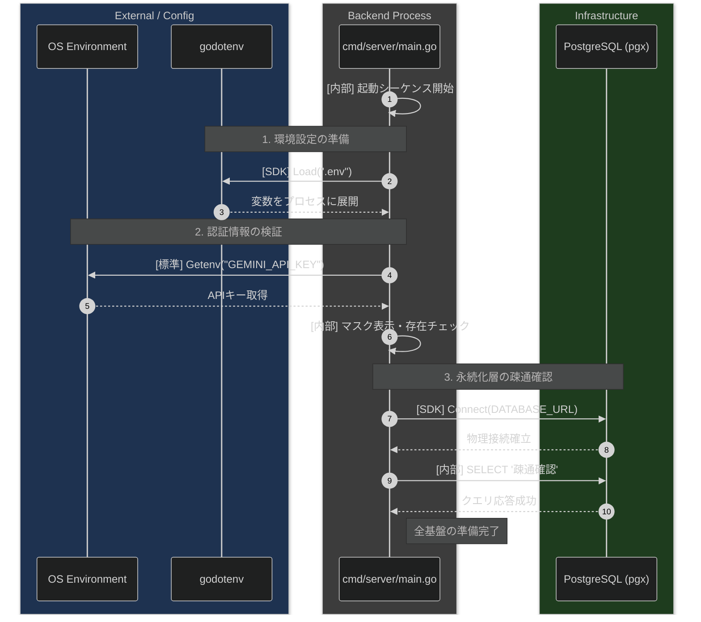
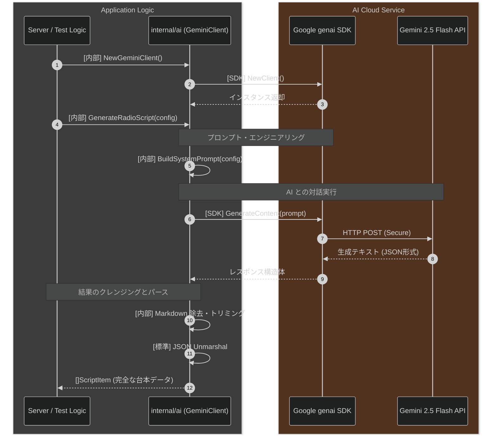
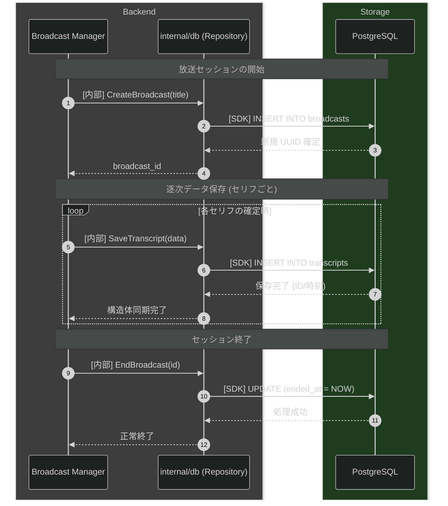

# AI Radio Room システム処理フロー

このドキュメントは、バックエンドにおける主要な処理の流れをシーケンス図として可視化したものである。

## 1. サーバー起動・初期化シーケンス
システムがリクエストを受け付け可能になるまでの基盤構築フロー。

## 2. 動的台本生成シーケンス
フロントエンドからの要求（GeneratorConfig）に基づいて AI が台本を書き上げるフロー。

## 3. データベース永続化シーケンス
放送内容を履歴として DB に記録し、整合性を保つフロー。

