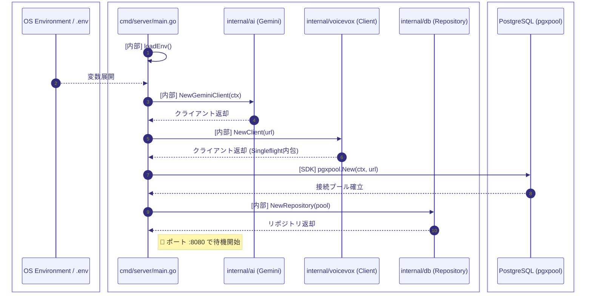
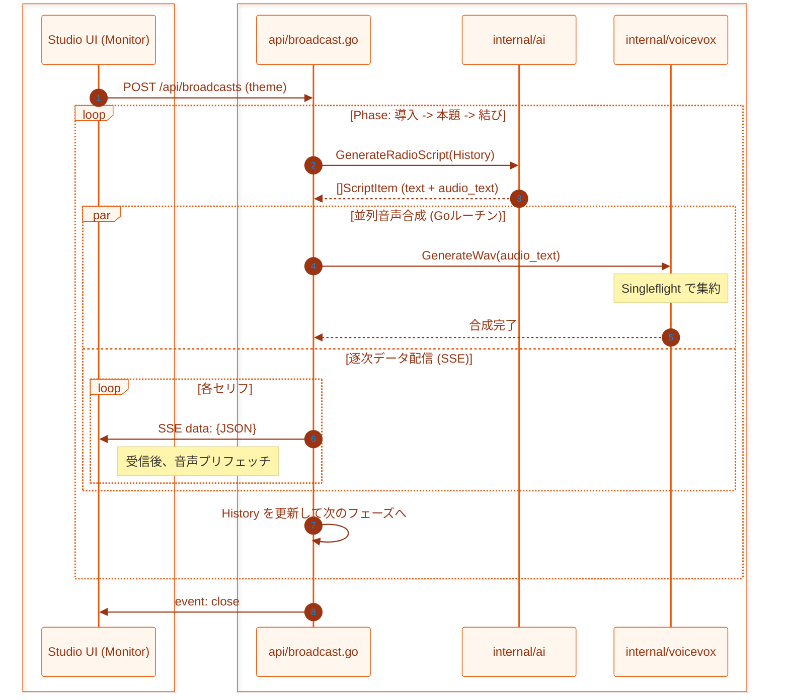
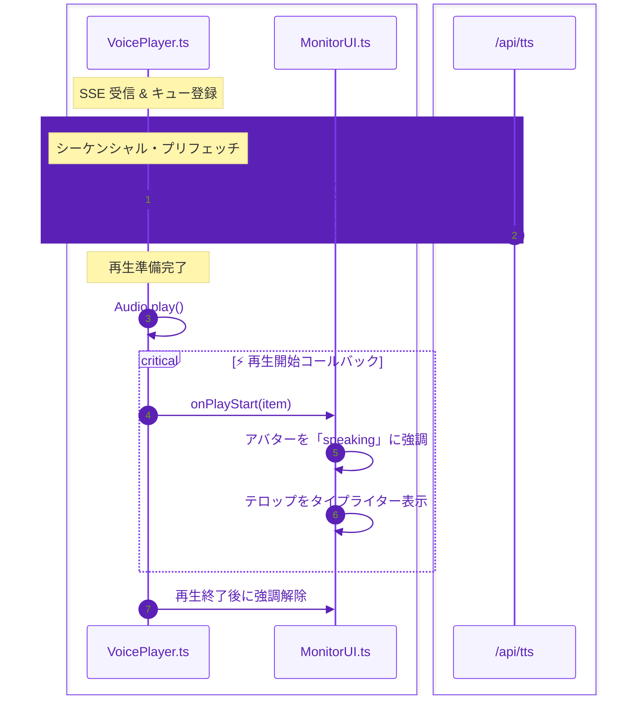
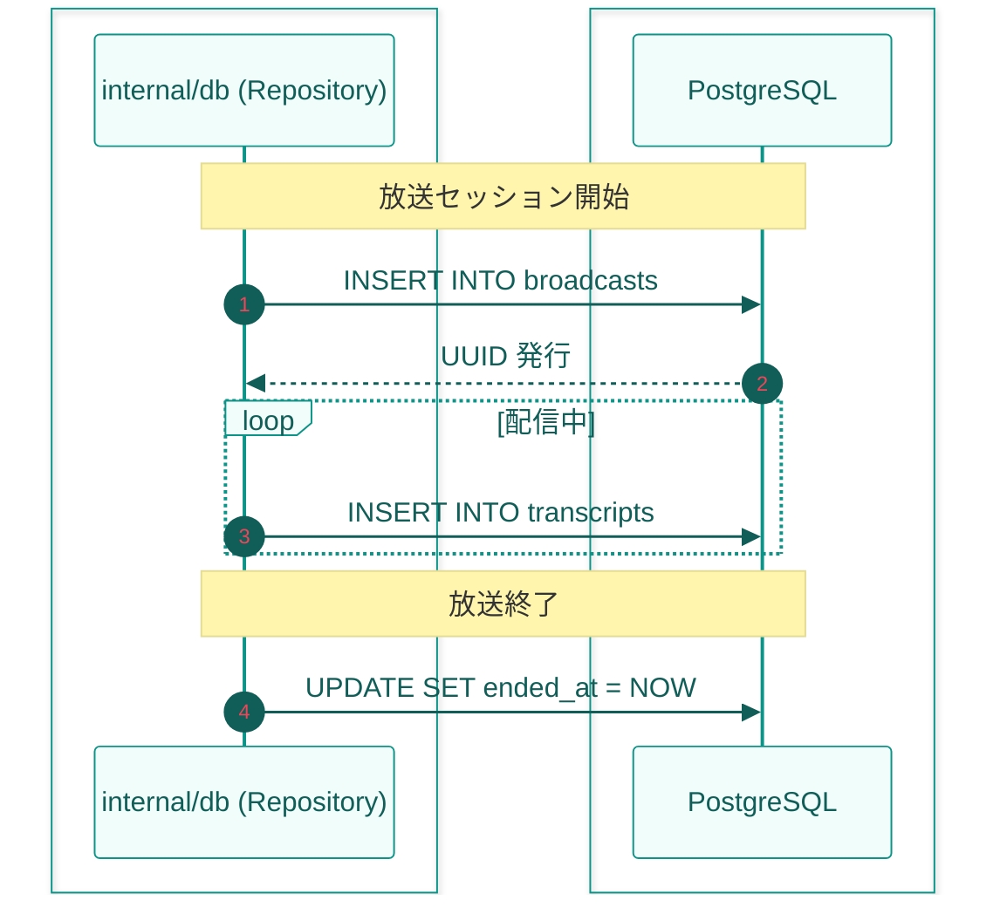

# 🌊 システム処理フロー (System Flow)

本ドキュメントは、AI Radio Room における主要な処理の流れをシーケンス図として可視化したものである。

---

## 🏗️ 1. サーバー起動・初期化シーケンス
> システムがリクエストを受け付け可能になるまでの基盤構築フロー。

---

## 🎙️ 2. 放送開始・複数フェーズ台本生成
> AI が「導入・本題・結び」の 3 段階で台本を書き、逐次配信するフロー。

---

## 🎧 3. 音声・UI 同期再生フロー
> フロントエンドで音声とアバター演出、テロップを完全に一致させるフロー。

---

## 🗄️ 4. データベース永続化
> 放送履歴と発言ログの記録。

